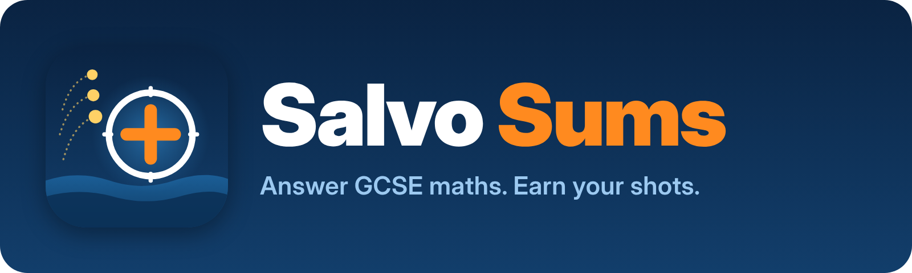

<p align="center"></p>

# Salvo Sums

A single-player Battleships game for iPhone and iPad where every shot is earned by answering a GCSE maths question. Play against the computer, sink its fleet, and learn from a worked explanation every time you get one wrong.

See [docs/PLAN.md](docs/PLAN.md) for the full project plan.

> The app is called **Salvo Sums**. The Xcode project, targets and folders still use the working name `BattleMaths`, which players never see.

## Requirements

- Xcode 16 or later
- iOS 17 or later

## Getting started

1. Open `BattleMaths.xcodeproj` in Xcode.
2. Select the **BattleMaths** target → **Signing & Capabilities** and choose your team.
3. Pick an iPhone or iPad simulator and press **⌘R** to run.
4. Press **⌘U** to run the engine tests and UI tests.

The engine tests can also run from Terminal without a simulator:

```sh
cd Packages/BattleEngine
swift test
```

## Structure

```
BattleMaths/              SwiftUI app target
BattleMathsUITests/       XCUITest end-to-end tests
Packages/BattleEngine/    Game logic as a local Swift package (no UI code)
  Sources/BattleEngine/   Models, rules, AI, question generators
  Tests/                  Swift Testing unit tests
docs/PLAN.md              Project plan
```

The app target uses Xcode's synchronized folders, so any file you add under `BattleMaths/` or `BattleMathsUITests/` is picked up automatically.

## Credits

Sound effects are CC0 by [Kenney](https://kenney.nl). See [docs/CREDITS.md](docs/CREDITS.md).
